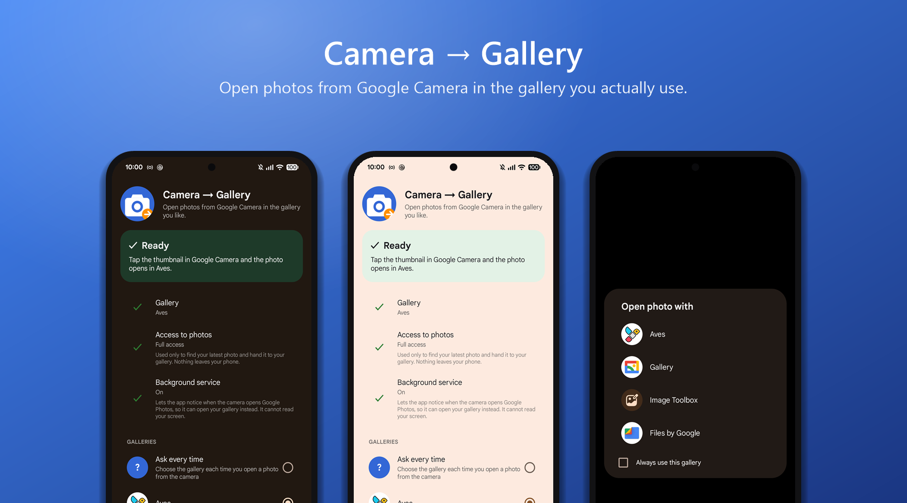
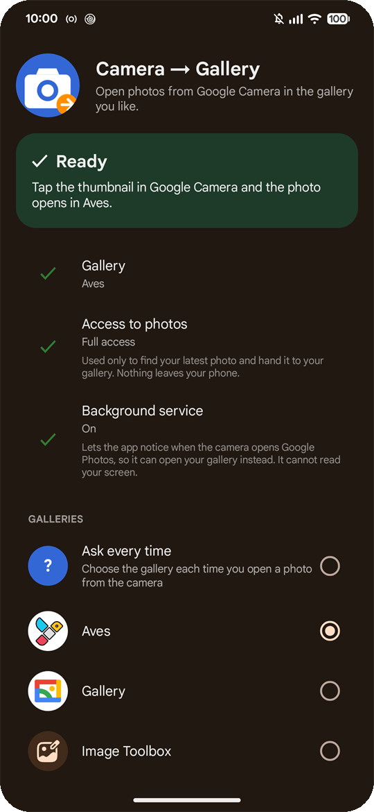
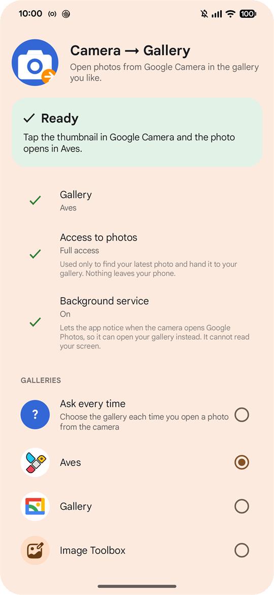
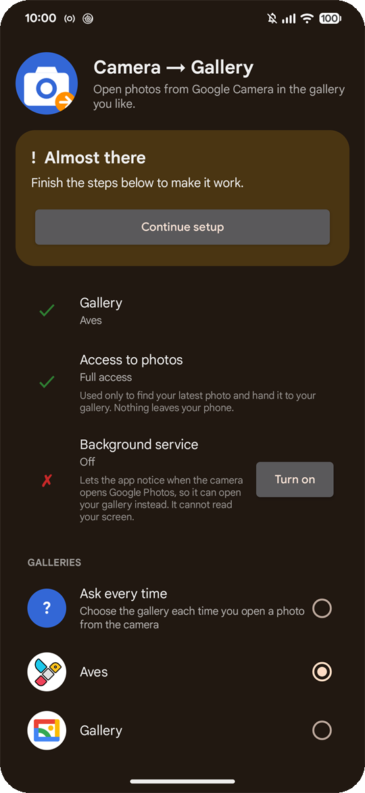
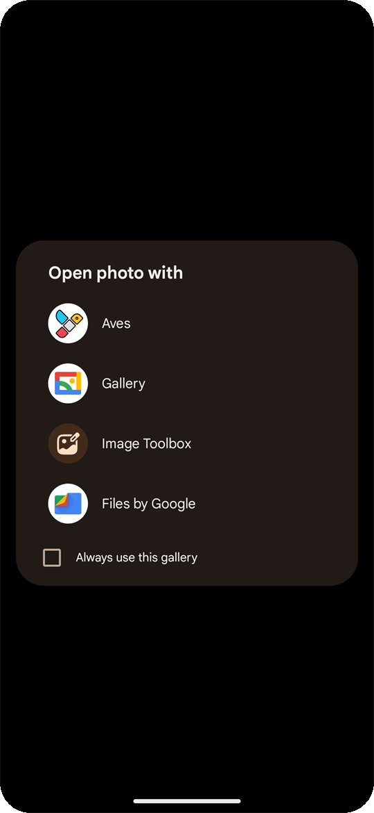
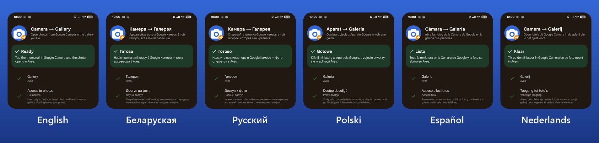

# Camera → Gallery

Makes the thumbnail in Google Camera (Pixel Camera) open your photo in the gallery you use, not in Google Photos. No root needed.

<p align="center">
  
</p>

Normally, when you tap the small preview after taking a photo, Google Camera opens Google Photos and
ignores your default gallery, because it launches Google Photos by name. This app changes that. The
photo opens in the gallery you pick, or you get an "Open with" list each time.

It has no internet permission, doesn't read your screen, and one APK works on any CPU
architecture (arm64, armv7, x86, x86_64) because there is no native code. Android 10 or newer.
The interface is in English, Belarusian, Russian, Polish, Spanish and Dutch.

<p align="center">
  
  
  
  
</p>

<p align="center">
  
</p>

I have only tested it on my Pixel 7 Pro (Android 17, Pixel Camera 10.4) with Aves and Google Gallery
Go. It should work with other phones, GCam ports and galleries, but I can't promise that. If you try
it, please send a [compatibility report](https://github.com/Mikhas-Rahulia/camera-to-gallery/issues/new?template=compatibility-report.md).

## Install

1. Download the APK from [Releases](https://github.com/Mikhas-Rahulia/camera-to-gallery/releases/latest) and install it. It is not on Google Play, which doesn't allow this kind of app.
2. Open **Camera → Gallery** and allow access to photos (choose "Allow all", otherwise it can only open the gallery's home screen instead of the exact photo).
3. Tap **Turn on** and enable the service in Android's accessibility settings.
4. Choose your gallery in the list, or leave "Ask every time".

If you install another gallery later, the app notices and asks again. If nothing new has been
installed, it never asks.

On Android 13 and newer the accessibility switch may be greyed out for apps installed from an APK.
Long-press the app icon, open App info, tap the three dots and choose "Allow restricted settings".

## How it works

Google Camera sends the photo straight to the Google Photos package, so Android's default-app
setting never gets a say. Without root, the only option is to react afterwards. The app has an
accessibility service that only receives the package and window name of newly opened windows. When
Google Photos' viewer opens right after a camera app, the service covers the screen with a black
layer (so you don't see Google Photos flash), presses Back, and opens the newest photo from
`DCIM/Camera` in your gallery. Swiping to earlier photos works as usual, in the gallery.

The service is declared with `canRetrieveWindowContent="false"`, so it can't read anything on the
screen. Photo access is used only to find the newest photo. Nothing leaves the phone. See
[PRIVACY.md](PRIVACY.md).

Battery use is negligible: the service only reacts to window changes, with no wake locks or
background jobs. I measured about 0.07 s of CPU time per photo.

Similar projects that take a different route (patching the camera, or a stub Google Photos app):
[Pixel Camera Patches](https://github.com/Gamer92000/pixelcamera-patches),
[google-pixel-camera-redirect](https://github.com/nermolov/google-pixel-camera-redirect).

## Problems

* **The service turned itself off.** Android disables an accessibility service whenever its app is force-stopped, which some memory cleaners and battery savers do. Turn it on again and exclude the app from such cleaners. The main screen shows "Off" when this happens.
* **The gallery opens on its home screen.** The app has no (or only partial) access to photos. Open it and choose "Allow all".
* **Google Photos still opens.** Check that the status card at the top is green and that a gallery is installed.
* **Nothing happens with my GCam port.** Open an issue with the camera's package name (`adb shell pm list packages | grep -i cam`).

## Pausing Google Photos (optional, advanced)

Google Photos can't be removed or disabled on most phones, and if you disable it Google Camera won't
open the thumbnail at all. You can suspend it instead with `adb`. This stops its background work and
notifications, and the app still redirects. Photo backup stops too. Do this at your own risk. I
only tried it on one phone.

```
adb shell pm suspend --user 0 com.google.android.apps.photos
adb shell pm unsuspend --user 0 com.google.android.apps.photos    # undo
```

## Build

You need Windows PowerShell, a JDK (17 or newer) and the Android SDK (platform 36, build-tools 36).
No Gradle.

```
powershell -ExecutionPolicy Bypass -File .\build.ps1
```

This creates `GalleryRedirect.apk`, signed with a key generated locally (`debug.keystore`, not in
git). Sign your own releases with your own key. Install with `adb install -r GalleryRedirect.apk`.

Source layout: `src/dev/gcamredirect/` has the accessibility service (`RedirectService`), gallery
and camera detection (`Galleries`, `CameraApps`), opening the photo (`Redirector`) and the two
screens (`MainActivity`, `PickerActivity`). Strings for each language are in `res/values*/`. A
Gradle project would be a welcome contribution, see [CONTRIBUTING.md](CONTRIBUTING.md).

## Legal

[MIT license](LICENSE), [privacy](PRIVACY.md), [terms](TERMS.md), [disclaimer](DISCLAIMER.md),
[third-party notices](THIRD_PARTY_NOTICES.md), [security](SECURITY.md).

By Mikhas Rahulia, Poland. Not affiliated with Google.
